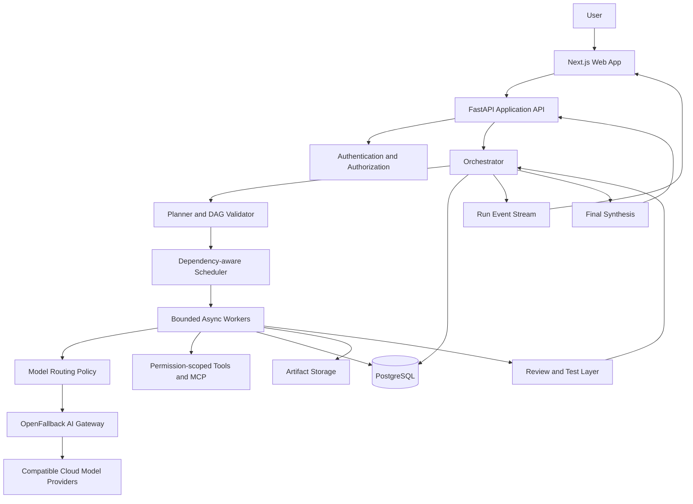

# OMNIMIND AI — Architecture

## Architectural rule

The orchestrator owns workflow state and policy. Models provide proposed plans and outputs; they do not own system state, permissions, or budget enforcement.

## Logical component diagram

## Trust boundaries

- The browser is untrusted; validate every request on the server.
- Model outputs and retrieved content are untrusted input.
- Tool execution must be mediated by explicit permissions and policy.
- Provider credentials must remain server-side.
- Artifacts and run data must be isolated by project authorization.
- External side effects require idempotency protection and, when appropriate, human approval.

## Execution sequence

1. API creates a run with a policy and budget snapshot.
2. Planner proposes tasks and acceptance criteria.
3. Server validates the DAG and stores the plan.
4. Scheduler dispatches ready tasks within concurrency limits.
5. Worker calls the model gateway through a provider-neutral interface.
6. Result and event are persisted before dependent work is released.
7. Reviewer or deterministic tests evaluate the output.
8. Failed tasks retry only when policy permits.
9. Synthesizer creates the final artifact from accepted outputs.
10. Run finalization checks all required tasks and reports exact status.

## Failure handling

| Failure | Expected response |
| --- | --- |
| Provider rate limit | Honor retry guidance where available; try a compatible provider if allowed |
| Provider timeout | Bounded retry; persist attempt state |
| Invalid request | Do not retry unchanged input blindly; surface diagnostics |
| No compatible provider | Mark task blocked or failed and explain why |
| Worker interruption | Resume from persisted state without duplicating completed side effects |
| Reviewer disagreement | Compare evidence and criteria; escalate if unresolved |
| Budget exhausted | Stop dispatching and report partial progress |
| User cancellation | Stop cancellable tasks and mark remaining work accurately |

## Deployment principles

- Keep the web UI, orchestration API, and gateway boundaries explicit.
- Verify existing repository and deployment configuration before changing infrastructure.
- Do not assume the current gateway deployment is healthy.
- Use environment-specific secrets and configuration.
- Add health checks, structured logs, and trace IDs.
- Run automated tests before promoting a deployment.
