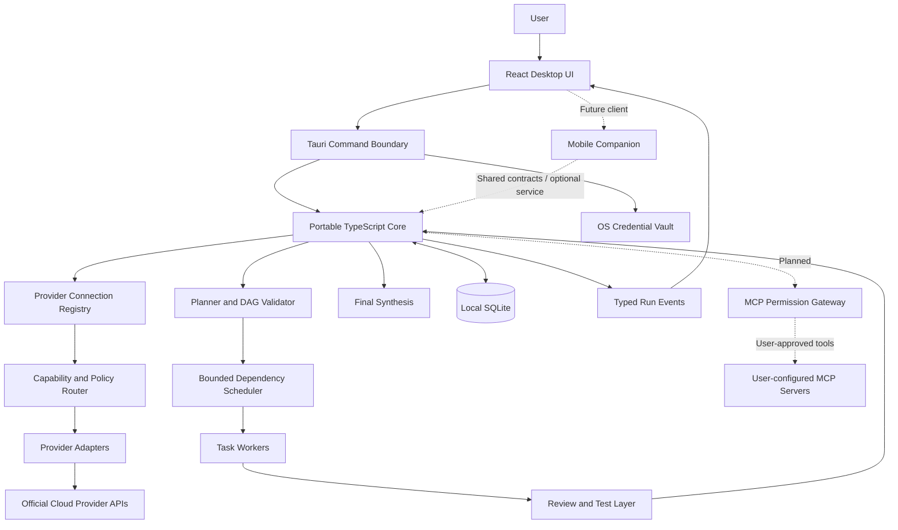

# OMNIMIND AI — Architecture

## Architecture decisions

- Desktop-first: Tauri 2 + React + TypeScript + Vite is the current proposed Windows client.
- Portable core: keep provider contracts, task planning, DAG validation, scheduling policy, and result synthesis independent of the UI.
- Local-first execution for the desktop MVP: keep run data on the user's device and call official provider APIs through a controlled native transport.
- Credential isolation: provider secrets live in an OS-backed secure vault, not SQLite or UI state.
- MCP tools: runtime MCP support is planned, not implemented. MCP client and server connections must be isolated behind a dedicated permission-enforcing service.
- Mobile later: share stable TypeScript contracts where practical; use platform-specific secure storage and permission boundaries.
- Gateway reuse is conditional. The existing Vercel deployment is failing and its source was not located in the inspected Framework-MCPs tree. Do not depend on it until verified.

## Logical component diagram

The MCP gateway shown is a target architecture only; it is not present in the current executable build. Developer workflow connectors used to modify the repository are separate from the app's runtime capabilities.

## Provider connection boundary

1. User chooses a provider and an officially supported connection method.
2. UI sends the secret to a narrowly scoped secure command; do not persist it in ordinary UI state longer than necessary.
3. The secure command stores it in the OS credential vault and returns a non-secret credential reference.
4. The provider adapter retrieves the credential only when needed.
5. The adapter sends requests to an approved HTTPS endpoint and redacts sensitive data from errors.
6. The connection registry records safe metadata and the result of the connection test.
7. Disabling a connection excludes it from routing without deleting the credential. Removing it deletes the credential and connection metadata; revoke remote OAuth grants where supported.

## MCP trust and execution boundary

1. A user explicitly configures a server and reviews its transport, executable or URL, declared capabilities, and requested permissions.
2. The client validates configuration and starts/connects only after explicit confirmation.
3. A dedicated policy gateway validates tool name, schema, permission scope, timeout, output size, and current user approval.
4. The model may propose a tool call but cannot authorize it or change permissions.
5. Server output is treated as untrusted data, sanitized for display, and clearly separated from policy instructions.
6. Consequential actions require a confirmation screen showing the target and arguments.
7. Audit events redact secrets and sensitive values; users can disable or remove a server and revoke credentials.

Do not support automatic server installation, shell-string execution, credential scraping, or unrestricted filesystem/network access. See [MCP Integrations](MCP_INTEGRATIONS.md) for transport and acceptance criteria.

## Run sequence

1. Validate request and execution policy.
2. Planner produces a structured plan and acceptance criteria.
3. Core validates the DAG, capability needs, privacy constraints, and resource budget.
4. Scheduler dispatches ready tasks up to configured concurrency.
5. Adapter executes a model call using the selected provider connection.
6. Persist output references and state events.
7. Reviewer or deterministic checks evaluate the output.
8. Retry transient failures within strict limits, or choose a compatible enabled fallback.
9. Synthesizer assembles accepted outputs.
10. Finalization reports successful, failed, skipped, and unverified tasks accurately.

## Trust boundaries

- UI input is untrusted; validate in the core and privileged command handlers.
- Model outputs and retrieved content are untrusted data, never policy instructions.
- Provider credentials are secret material and must never enter model context or logs.
- Custom provider URLs require validation and restrictions to avoid SSRF or local-network access.
- Tools and MCP servers require explicit permission scopes and timeouts.
- External side effects require idempotency protection and, where appropriate, user approval.
- Hosted sync or orchestration is a separate trust boundary and must not be silently introduced.

## Failure handling

| Failure | Response |
| --- | --- |
| Invalid credentials | Mark `AUTH_REQUIRED`; show safe diagnostic and allow editing/removal |
| Provider rate limit | Honor retry metadata where available; apply bounded delay or compatible fallback |
| Timeout | Cancel request where possible; retry only within policy |
| Unsupported capability | Exclude that model from the task or choose a compatible one |
| No eligible provider | Block task and explain the constraint |
| Worker/app interruption | Resume from persisted state without duplicating completed side effects |
| Reviewer disagreement | Compare evidence and criteria; ask the user if unresolved |
| Budget exhausted | Stop dispatching and report partial completion |
| User cancellation | Stop cancellable tasks and preserve accurate state |
| Credential vault unavailable | Fail closed; do not silently write secrets to a plaintext fallback |
| MCP server unavailable or malformed | Disable the server for the current run, record a redacted diagnostic, and do not bypass permissions |

## Build and release principles

- Keep the desktop UI, privileged Tauri commands, portable core, and provider adapters separated.
- Validate Windows support and secure-storage integration before release.
- Use lockfiles and reproducible build scripts.
- Run type checks, unit tests, adapter contract tests, and packaging checks before release.
- Do not claim the gateway is healthy unless API and deployment checks pass.
- Do not create cloud resources or introduce hosted data flows without a documented need and approval.
